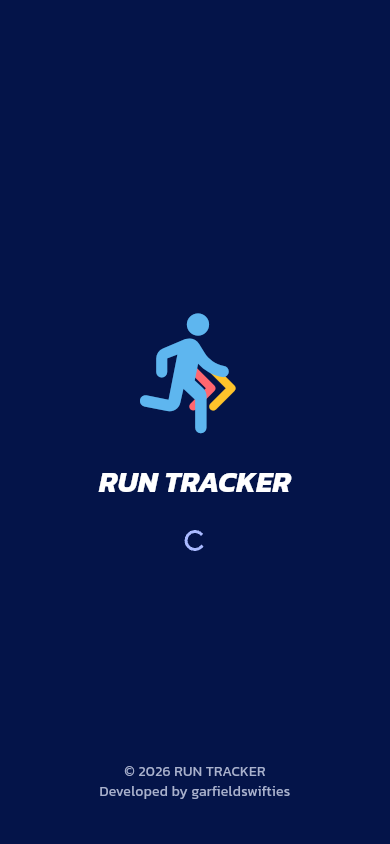
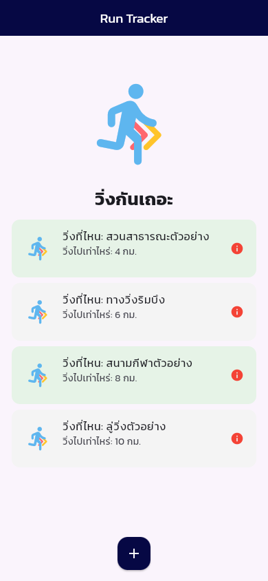
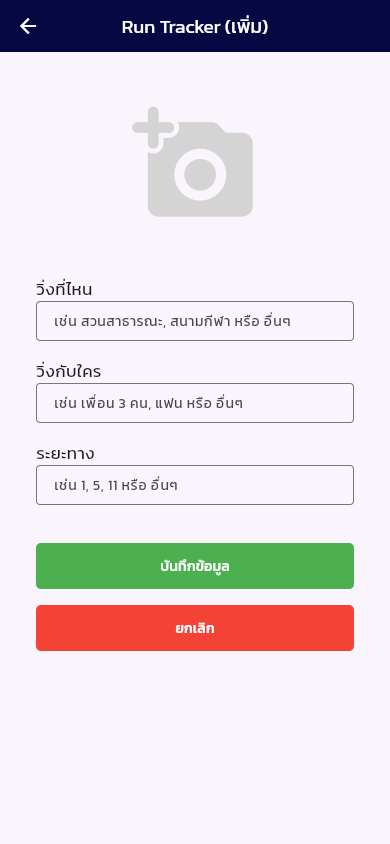
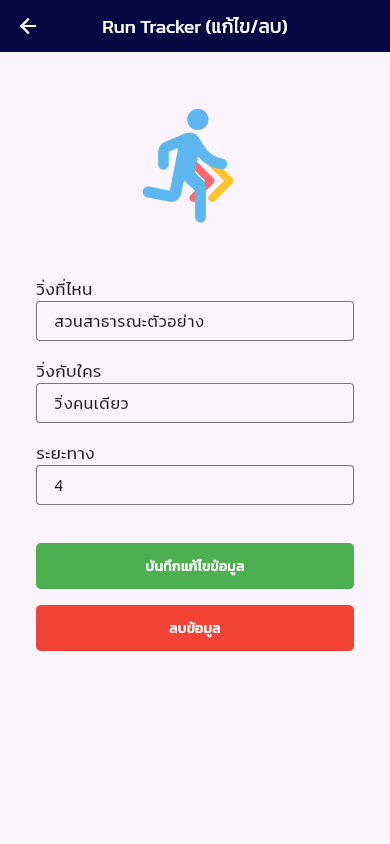
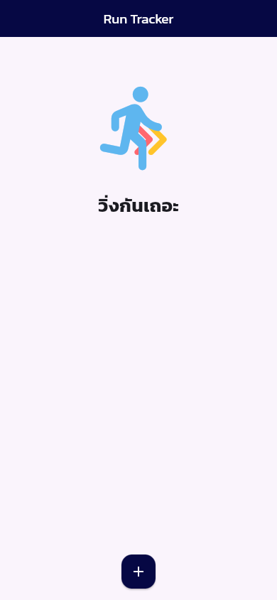
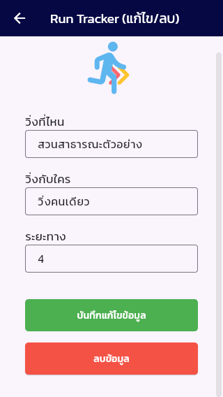

# Run Tracker

## แนะนำโปรเจกต์

Run Tracker เป็นแอปบันทึกกิจกรรมวิ่งสำหรับฝึกพัฒนาแอป Flutter ที่เชื่อมต่อ Supabase ผู้ใช้บันทึกสถานที่ ผู้ร่วมวิ่ง และระยะทางเป็นกิโลเมตร พร้อมแนบรูปได้หนึ่งรูปต่อรายการ

## ฟังก์ชันการทำงาน

- แสดงรายการล่าสุดก่อน โดยเรียงตามเวลาสร้างและ UUID
- บันทึกรายการโดยมีหรือไม่มีรูป แก้ข้อมูล เปลี่ยนรูป และลบรายการได้
- Android เปิดกล้องเพื่อถ่ายรูป ส่วนเว็บเปิดตัวเลือกไฟล์
- โหลดรายการใหม่เมื่อกลับจากหน้าเพิ่มหรือแก้ไข ปุ่มยกเลิกบนหน้าเพิ่มล้างฟอร์มและรูปที่เลือก
- ตรวจช่องกรอก รูป และระยะทางก่อนส่งข้อมูล พร้อมแสดงสถานะระหว่างโหลดและข้อความเมื่อดำเนินการไม่สำเร็จ

## ภาพหน้าจอแอปพลิเคชัน

ภาพจาก Web build ที่แสดงผลจริงใน Chrome Headless ขนาด 390 × 844 โดยใช้ข้อมูลสังเคราะห์จาก backend จำลอง

| Splash | รายการ | เพิ่ม | แก้ไข / ลบ |
| --- | --- | --- | --- |
|  |  |  |  |

| รายการว่าง | แบบฟอร์มบนหน้าจอขนาดเล็ก (320 × 568) |
| --- | --- |
|  |  |

## เทคโนโลยีที่ใช้

| เทคโนโลยี | หน้าที่ |
| --- | --- |
| Flutter, Dart และ `material_ui` | หน้าจอ Material สำหรับ Web และ Android |
| `supabase_flutter` | อ่านและบันทึกข้อมูลกับ PostgreSQL และจัดการไฟล์ใน Supabase Storage |
| `image_picker` | เปิดกล้องบน Android หรือเลือกไฟล์บนเว็บ |
| Kanit | ฟอนต์ไทยและอังกฤษที่รวมกับแอป |

## โครงสร้างโปรเจกต์

| ส่วน | หน้าที่ |
| --- | --- |
| `lib/main.dart` | โหลดค่าการเชื่อมต่อและเปิด Splash |
| `lib/views/` | หน้าจอ Splash, รายการ, เพิ่ม และแก้ไข/ลบ |
| `lib/models/` | Model `Run` และข้อมูลรูปที่ตรวจชนิดแล้ว |
| `lib/services/` | คำสั่ง Database, Storage และการตรวจผลการเขียน |
| `lib/widgets/` | ฟอร์มร่วมและส่วนแสดงโลโก้หรือรูป |
| `assets/fonts/` | ฟอนต์ Kanit พร้อมใบอนุญาต |
| `test/` | Model tests, Widget tests และชุดทดสอบ Supabase ที่เปิดรันได้ตามต้องการ |

## การติดตั้งและใช้งาน

ต้องมี Flutter 3.50, Dart 3.14 และ Chrome สำหรับ Web หากจะรันบน Android ให้ติดตั้ง Android SDK และเชื่อมต่ออุปกรณ์ที่ Flutter มองเห็น

### 1. สร้าง Supabase Project สำหรับทดลอง

สร้างโปรเจกต์ใหม่ใน Supabase Dashboard แล้วตรวจว่า **Data API** เปิดอยู่และเปิดเผย schema `public` ตั้งค่าให้ตารางใหม่ไม่รับ API grants อัตโนมัติ หรือใช้คำสั่งถอนสิทธิ์ใน SQL ด้านล่างเพื่อเริ่มจากสิทธิ์ที่ชัดเจน ตัวอย่างนี้เปิด anonymous CRUD และ public URL ของรูป ให้ใช้เฉพาะกับโปรเจกต์ทดลองและข้อมูลสังเคราะห์ [Supabase Data API](https://supabase.com/docs/guides/api/securing-your-api)

### 2. สร้างตารางและกำหนดสิทธิ์

| คอลัมน์ | ชนิด PostgreSQL | ค่าเริ่มต้น | Database constraint |
| --- | --- | --- | --- |
| `id` | `uuid` | `gen_random_uuid()` | Primary key |
| `created_at` | `timestamptz` | `now()` | `NOT NULL` |
| `runWhere` | `text` | — | `NOT NULL` และต้องมีอักขระที่ไม่ใช่ช่องว่าง |
| `runPerson` | `text` | — | `NOT NULL` และต้องมีอักขระที่ไม่ใช่ช่องว่าง |
| `runDistance` | `integer` | — | `NOT NULL` และมากกว่า 0 |
| `runImageUrl` | `text` | `NULL` โดยปริยาย | เก็บ public URL เมื่อมีรูป |

ในแอป ฟอร์มจะตัดช่องว่างหัวท้าย ตรวจว่ากรอกครบ และรับเฉพาะระยะทางจำนวนเต็มระหว่าง 1 ถึง 2,147,483,647 กิโลเมตร ฐานข้อมูลบังคับชนิดและ constraints ในตารางซ้ำเมื่อได้รับข้อมูล รูปเป็นตัวเลือกและแอปตรวจชนิด ขนาด และการอ่านไฟล์ก่อนอัปโหลด

รัน SQL ต่อไปนี้หนึ่งครั้งใน SQL Editor ของ **โปรเจกต์ทดลองที่สร้างใหม่** ชื่อคอลัมน์ camelCase ต้องใช้ double quotes ใน SQL Grant อนุญาต operation บนตาราง ส่วน RLS อนุญาตให้ `anon` ใช้แต่ละ operation กับทุกแถวที่ผ่าน constraints ที่เกี่ยวข้อง

```sql
begin;

create table public.run_tb (
    id uuid primary key default gen_random_uuid(),
    created_at timestamptz not null default now(),
    "runWhere" text not null,
    "runPerson" text not null,
    "runDistance" integer not null,
    "runImageUrl" text,
    constraint run_tb_where_not_blank check ("runWhere" ~ '[^[:space:]]'),
    constraint run_tb_person_not_blank check ("runPerson" ~ '[^[:space:]]'),
    constraint run_tb_distance_positive check ("runDistance" > 0)
);

alter table public.run_tb enable row level security;
revoke all privileges on table public.run_tb from public, anon, authenticated;
grant select, insert, update, delete on table public.run_tb to anon;

create policy run_tb_anon_select on public.run_tb
    for select to anon using (true);
create policy run_tb_anon_insert on public.run_tb
    for insert to anon with check (true);
create policy run_tb_anon_update on public.run_tb
    for update to anon using (true) with check (true);
create policy run_tb_anon_delete on public.run_tb
    for delete to anon using (true);

commit;
```

### 3. สร้าง Storage Bucket

ใน **Storage → New bucket** สร้าง `run_bk` แบบ **Public** ตั้งขนาดสูงสุด **5 MB** และอนุญาตเฉพาะ `image/jpeg`, `image/png` และ `image/webp` แอปสร้างชื่อไฟล์ใน `runs/<ชื่อที่สร้างใหม่>.<นามสกุล>` อัตโนมัติ

เพิ่ม policies ต่อไปนี้ใน SQL Editor เฉพาะโปรเจกต์ทดลอง โดยใช้สิทธิ์ Storage ที่ Supabase จัดเตรียมไว้ `SELECT` จำเป็นสำหรับการลบผ่าน Storage API ส่วนการเปิดรูปจาก public URL ใช้สถานะ Public ของ bucket การเปลี่ยนรูปทำผ่าน `INSERT` ไฟล์ใหม่แล้ว `DELETE` ไฟล์เดิม จึงไม่ต้องมี Storage `UPDATE` policy [Supabase Storage](https://supabase.com/docs/guides/storage/buckets/creating-buckets) · [Flutter Storage remove](https://supabase.com/docs/reference/dart/storage-from-remove)

```sql
begin;

create policy a08_run_bk_anon_select on storage.objects
    for select to anon
    using (bucket_id = 'run_bk' and name like 'runs/%');

create policy a08_run_bk_anon_insert on storage.objects
    for insert to anon
    with check (bucket_id = 'run_bk' and name like 'runs/%');

create policy a08_run_bk_anon_delete on storage.objects
    for delete to anon
    using (bucket_id = 'run_bk' and name like 'runs/%');

commit;
```

### 4. ตั้งค่าและรันแอป

เปิดเทอร์มินัลที่โฟลเดอร์โปรเจกต์ แล้วคัดลอกไฟล์ [ตัวอย่างการตั้งค่า](supabase.example.json) ไปยัง `.local/supabase.json`

**Windows PowerShell**

```powershell
flutter pub get
New-Item -ItemType Directory -Force .local
Copy-Item supabase.example.json .local/supabase.json
```

**macOS / Linux**

```bash
flutter pub get
mkdir -p .local
cp supabase.example.json .local/supabase.json
```

แทนค่า placeholder ใน `.local/supabase.json` ด้วย Project URL ที่ลงท้ายด้วย `.supabase.co` ใน `SUPABASE_URL` และ publishable key ที่ขึ้นต้นด้วย `sb_publishable_` ใน `SUPABASE_PUBLISHABLE_KEY` ของโปรเจกต์ทดลอง จากนั้นใช้คำสั่งเดียวกันได้บนทั้งสองระบบ

```sh
flutter run -d chrome --dart-define-from-file=.local/supabase.json
```

สำหรับ Android ใช้ `flutter devices` เพื่อหา device ID แล้วใช้ ID นั้นแทน `chrome` แอปอ่านค่าจาก `String.fromEnvironment` ผ่าน `--dart-define-from-file` โดย Git ข้ามไฟล์ใน `.local/`

## การทดสอบและข้อจำกัด

```powershell
dart format lib test
flutter analyze
flutter test
flutter build web --dart-define-from-file=.local/supabase.json
flutter build apk --debug --dart-define-from-file=.local/supabase.json
```

Model และ Widget tests ครอบคลุมรูปแบบ JSON การตรวจรูปและฟอร์ม การนำทาง การโหลดซ้ำ และการป้องกันการกดบันทึกซ้ำ ชุดทดสอบ Supabase จริงใช้ Flutter client กับข้อมูลสังเคราะห์ ครอบคลุม CRUD, Public URL, การเปลี่ยนรูป และการเก็บกวาดเฉพาะรายการที่สร้างขึ้น

ผลล่าสุดบน Flutter 3.50 คือ analyzer ไม่พบปัญหา, Model/Widget tests ผ่าน 6 รายการ, Web build และ APK debug build ผ่าน Chrome Headless ผ่านที่ 390 × 844 และ 320 × 568 ทดสอบ Supabase จริงผ่านทั้ง CRUD กับรูปและการโหลดรายการซ้ำหลังนำทางบน Web ส่วน Android Emulator API 35 เปิดแอป เปิดกล้อง และยกเลิกกลับแบบฟอร์มได้

การทดสอบ Supabase CRUD บน Android, iOS และอุปกรณ์จริงยังไม่ได้ดำเนินการ การเทียบ UI ใช้ mockups ที่บันทึกไว้ โดยยังไม่ได้ตรวจ layer หรือยืนยันขนาดเฟรมต้นฉบับใน Figma ขนาด 390 × 844 เป็น viewport ที่ใช้ทดสอบ

```powershell
$env:RUN_TRACKER_LIVE_TEST = '1'
flutter test test/live_supabase_test.dart
Remove-Item Env:RUN_TRACKER_LIVE_TEST
```

แอปนี้เป็นโปรเจกต์การศึกษาที่ไม่มีระบบ Authentication ผู้ใช้ที่เข้า Data API ผ่าน role `anon` สามารถอ่าน เพิ่ม แก้ไข และลบข้อมูลร่วมกันได้ เพราะ RLS ชุดนี้ไม่ได้แบ่งข้อมูลรายผู้ใช้ ผู้ที่มี public URL สามารถเปิดรูปใน bucket ได้ ใช้เฉพาะข้อมูลและภาพสังเคราะห์ การตั้งค่านี้ไม่เหมาะกับข้อมูลส่วนบุคคลหรือ Production ที่ต้องแยกสิทธิ์รายผู้ใช้

Publishable key มองเห็นได้จากแอปที่ build แล้ว การควบคุมข้อมูลขึ้นอยู่กับ grants และ policies เก็บ Database Password, Secret Key และ Service Role Key ไว้นอกแอปและ repository เมื่อสิ้นสุดการทดลอง ให้ถอน table grants และ Storage policies ของ `anon` และปรับ bucket เป็น Private เพื่อยุติการเปิดรูปผ่าน public URL

## เครดิตและสิทธิ์การใช้งาน

- **การออกแบบและตัวอย่างรายวิชา** หน้าจออ้างอิงจาก Figma และตัวอย่าง Workshop ของ NinniN SAU TEAM ในรายวิชาการพัฒนาโปรแกรมประยุกต์สำหรับอุปกรณ์เคลื่อนที่ ลิขสิทธิ์ของทรัพยากรอ้างอิงเป็นของเจ้าของเดิม
- **ฟอนต์และแพ็กเกจ** Kanit โดย The Kanit Project Authors ใช้ SIL OFL 1.1 พร้อม [ไฟล์ใบอนุญาต](assets/fonts/OFL.txt) ดูใบอนุญาตของ [Material UI](https://pub.dev/packages/material_ui/license), [image_picker](https://pub.dev/packages/image_picker/license), [supabase_flutter](https://pub.dev/packages/supabase_flutter/license) และ [http](https://pub.dev/packages/http/license)
- **ทรัพยากรภายนอกและเครื่องหมายการค้า** สัญลักษณ์ในแอปใช้ [Material Icons](https://github.com/google/material-design-icons/blob/master/LICENSE) ส่วน launcher icon และรูปที่ใช้ทดสอบสร้างขึ้นสำหรับงานนี้ ชื่อ Flutter และ Supabase ใช้ระบุเทคโนโลยีที่ใช้งาน
